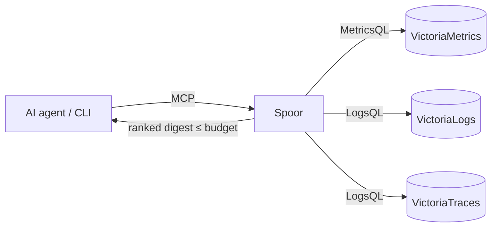

# Spoor

**Spoor tells an AI agent what changed in your services, and where it started, in a few hundred tokens.**

[](https://github.com/asinha07/spoor/actions/workflows/ci.yml)
[](LICENSE)

Spoor is an open-source [MCP](https://modelcontextprotocol.io) server and CLI for the VictoriaMetrics observability
stack (VictoriaMetrics, VictoriaLogs, VictoriaTraces). When something breaks, an agent asks Spoor *"what changed in
the last 30 minutes?"* and gets back a short, ranked answer across metrics, logs and traces, with the service where
the failure **started** at the top and its echoes in other services labelled as such.

> *Spoor* (n.): the track or trail left by an animal. Spoor follows the trail a failure leaves in your telemetry back
> to where it started.

```
$ spoor what-changed --since 30m
```

```json
{
  "summary": "11 change(s) in 3 services. Strongest: payment — Failures start here, in \"POST /charge\" (100% of 100 failed traces). Also: payment — Span \"POST /charge\" errors 0.2% → 43.7% (229 spans). … Errors at their usual rate (not new) in: product-catalog, recommendation, ad.",
  "findings": [
    {"service": "payment",  "signal": "traces",  "kind": "error_origin",    "score": 0.99, "title": "Failures start here, in \"POST /charge\" (100% of 100 failed traces)"},
    {"service": "payment",  "signal": "logs",    "kind": "new_log_pattern", "score": 0.94, "title": "New error log pattern: \"charge failed: card processor returned <N> for order <N>\""},
    {"service": "payment",  "signal": "metrics", "kind": "error_rate_up",   "score": 0.92, "title": "Error rate up: 0.2% → 40.5%", "onset": "2026-10-16T09:50:00Z"},
    {"service": "checkout", "signal": "logs",    "kind": "spiking_log_pattern", "score": 0.74, "title": "Error log pattern spiking: \"call to payment.Charge failed with status <N>\" — originates in payment"}
  ],
  "coverage": {"metrics": "ok", "logs": "ok", "traces": "ok"}
}
```

Findings carry evidence links to the query behind them (when the token budget allows), so a human can check the
agent's work in one click.

## Why use it

In a microservice failure, the broken service and every caller of it all light up. An agent with only raw query
tools has to decide what to query, compare against "normal" itself, page through results and work out which
service is the cause and which are echoes. It burns tool calls and tokens, and often blames the loudest symptom or
an error that was always there.

Spoor does that work in plain, deterministic Go and hands the agent the conclusion's evidence:

- **Cross-signal:** request rate, error rate, latency, CPU, memory and consumer lag; new and spiking error-log
  patterns; per-span errors and latency, all for the same window against the same baseline.
- **Cause vs. echo:** trace trees show where failures start and where latency is added. Callers that merely
  suffer are demoted and labelled `— originates in payment`.
- **Steady errors called out:** errors that were already there are listed as `steady_errors`, "not a new problem",
  so agents stop blaming them.
- **Bounded output:** every tool takes `budget_tokens` (default 800).
- **Honest about gaps:** `coverage` says when a backend failed or had no data, or the baseline was empty. "No
  change" never stands in for "no data".
- **No LLM inside, read-only:** same input, same output; only query endpoints are ever called.

### Measured

The [benchmark](docs/benchmark.md) runs Claude Code headless on six incidents (five faults and a no-fault control),
five times each, once with the official VictoriaMetrics MCP servers alone and once with Spoor added.
On Claude Haiku, 60 isolated sessions:

| | Official Victoria MCP servers | + Spoor |
| --- | --- | --- |
| Correct root cause, fault scenarios | 19/25 | **25/25** |
| Correct answer, all scenarios incl. "nothing is wrong" | 23/30 | **30/30** |
| Median tool calls per investigation | 24 | **10** |
| Median time | 55 s | **23 s** |
| Total cost | $0.60 | **$0.19** (−68%) |

Synthetic incidents and one small model, so treat it as a first data point. Method, per-scenario results and
caveats: [docs/benchmark.md](docs/benchmark.md).

## Quickstart

Requires Go 1.25+, Docker and `jq`. About five minutes.

```sh
git clone https://github.com/asinha07/spoor && cd spoor
make it-up          # empty VictoriaMetrics, VictoriaLogs, VictoriaTraces in Docker
make demo-data      # six synthetic incidents; ground truth in scenarios/out/
make build

T=scenarios/out/payment-failure.truth.json
./bin/spoor what-changed --since $(jq -r .since $T) --until $(jq -r .until $T) --pretty
```

Connect it to Claude Code:

```sh
claude mcp add spoor \
  -e SPOOR_METRICS_URL=http://localhost:8428 \
  -e SPOOR_LOGS_URL=http://localhost:9428 \
  -e SPOOR_TRACES_URL=http://localhost:10428 \
  -- "$PWD/bin/spoor" serve
```

Run it from the `spoor` directory (or add `-s user` to register it everywhere), then ask Claude: *"Something is
failing in the shop. What changed, and where did it start?"*

Other clients, your own backends and config: **[Getting started](docs/getting-started.md)**.

## Tools

| Tool | Returns |
| --- | --- |
| `what_changed` | Ranked changes across all signals, with cause/echo attribution, for one service or all. Start here. |
| `new_errors` | Error log patterns that are new or spiking, with counts, first-seen time and a redacted example. |
| `trace_diff` | Span names that got slower or started failing, with an example trace ID. |
| `list_services` | Services in the window and which signals have data for each. |

Inputs: `service`, `since`, `until`, `baseline` (`previous`, `1d`, `7d`), `budget_tokens`.
Full reference: [docs/tools.md](docs/tools.md).

## How it works



For a window and a baseline (by default, the six windows just before it), Spoor scores every metric with a robust
z-score, compares error-log patterns with a Poisson test, compares span error rates and p95s, walks failed traces to
the span where each failure started, boosts changes confirmed by more than one signal, and trims the result to the
token budget. Details: [architecture](docs/architecture.md) · [scoring and attribution](docs/how-it-works.md).

## Run it for a team

`spoor serve --http :8080 --auth-token …` serves MCP over streamable HTTP with bearer-token auth, `/healthz` and
Prometheus `/metrics`. Ready-made, hardened manifests:

- Kubernetes (Kustomize): [`deploy/kubernetes/`](deploy/kubernetes/)
- Docker Compose: [`deploy/docker/`](deploy/docker/)
- systemd: [`deploy/systemd/`](deploy/systemd/)

Security, sizing, monitoring and upgrades: **[Production guide](docs/production.md)**.

## Verified on the OpenTelemetry Demo

On the [OpenTelemetry Demo](https://github.com/open-telemetry/opentelemetry-demo) v3.1.0 (about 20 real
services), a 50% payment failure came back as "payment: failures start here, in `charge`", with checkout and
frontend errors labelled "originates in payment" (732 tokens); the `adHighCpu` fault came back as the single
finding "ad: CPU up 0.07 → 3.97 cores" (192 tokens). Reproduce it: [`deploy/demo/`](deploy/demo/README.md).

## Documentation

| | |
| --- | --- |
| [Getting started](docs/getting-started.md) | Install, try, connect an agent |
| [Production](docs/production.md) | Kubernetes, Docker, systemd, security, monitoring |
| [Configuration](docs/configuration.md) | Every option and recipes for common setups |
| [Tools](docs/tools.md) | Inputs and response format |
| [Architecture](docs/architecture.md) · [How it works](docs/how-it-works.md) | Design and scoring |
| [Benchmark](docs/benchmark.md) · [Comparison](docs/comparison.md) | Why use it, and what else exists |
| [Troubleshooting](docs/troubleshooting.md) · [FAQ](docs/faq.md) | When something looks wrong |

## Status and limitations

Early (pre-1.0). Tool output fields may still change between minor versions; see the [changelog](CHANGELOG.md).

- VictoriaMetrics stack only for now. Prometheus, Loki and Tempo adapters are next.
- Cause/echo attribution needs traces; without them Spoor still ranks metric and log changes.
- Attribution reads at most 50,000 span rows per read; on very busy systems a trace can be cut.
- The benchmark uses synthetic incidents written by the author and one model; treat it as a first data point.

More in [how-it-works.md](docs/how-it-works.md#known-limitations).

## Roadmap

- Prometheus, Loki and Tempo adapters
- "Since the last deploy" windows from Kubernetes rollouts
- HolmesGPT toolset
- Kafka consumer-group digest
- Benchmark on the OpenTelemetry Demo and larger models

## Contributing

Issues and pull requests are welcome. `make test` needs nothing but Go; see [CONTRIBUTING.md](CONTRIBUTING.md).
Security issues: [SECURITY.md](SECURITY.md).

## License

Apache-2.0. See [LICENSE](LICENSE).
