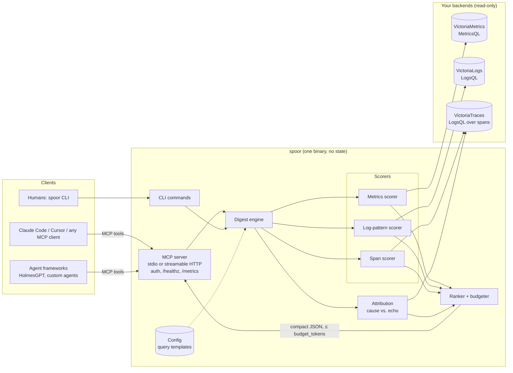

# Architecture

Spoor is a single stateless Go binary. It sits between an AI agent and your observability backends, runs a fixed
set of read-only queries, and turns the answers into a short ranked digest.

## Components

| Package | Responsibility |
| --- | --- |
| `cmd/spoor` | Entry point. `serve` (MCP over stdio or HTTP), the CLI commands, which call the same engine, and `doctor`, which checks what Spoor can see in your backends. |
| `internal/server` | MCP tool definitions and their JSON schemas, server instructions, HTTP handler with bearer-token auth, `/healthz`, `/metrics`, structured tool-call logs. |
| `internal/digest` | The engine. One scorer per signal, attribution, ranking, steady errors, redaction, the token budgeter and `doctor`. Pure functions over backend responses, so it is deterministic and testable from recordings. |
| `internal/backend` | Thin HTTP clients for VictoriaMetrics (`/api/v1/query`, `/api/v1/query_range`, label values) and LogsQL (`/select/logsql/query`), used for both VictoriaLogs and VictoriaTraces. Only query paths are allowed. |
| `internal/window` | Parses `since` / `until` / `baseline` into a window, a baseline range and its sub-windows. |
| `internal/config` | YAML + environment configuration. Every query is a template, so naming differences are a config change, not a code change. Unknown keys are rejected. |
| `internal/links` | Builds VMUI evidence links for each finding. |
| `internal/telemetry` | Spoor's own Prometheus metrics. |
| `internal/gen`, `cmd/spoorgen` | Synthetic incident generator with ground truth (six scenarios), used by tests, demos and the benchmark. |
| `internal/replay`, `internal/cases` | Record/replay of backend responses for offline golden tests. |

## Request flow

One `what_changed` call, end to end:

1. **Parse the window.** `since=30m` with `baseline=previous` becomes a 30-minute window plus six 30-minute
   sub-windows immediately before it (configurable). `1d` / `7d` use the same window one day or one week earlier.
2. **Find services.** One cheap query per backend lists the services seen across baseline and window, so a service
   that went silent during the window is still checked. Ignored services (load generators, collectors) are skipped.
3. **Score, in parallel.**
   - Logs, for all services at once in three or four parallel queries: error lines normalized into patterns
     server-side (JSON message fields extracted; IDs, numbers, stack traces removed) for the window and the
     baseline, with exact error counts per sub-window, plus line totals (all, without a severity field, without a
     service field) for the window and each sub-window.
   - Metrics and traces, per service (four at a time): request rate, error rate, p95 and configured resource
     metrics (CPU, memory, consumer lag) for the window and each sub-window; per span name, count, error count and
     p95 in the window and the baseline.
4. **Check the baseline.** Findings for a signal whose baseline period holds no data are dropped and the gap is
   reported, because against an empty baseline everything looks new.
5. **Attribute.** If anything changed, Spoor reads the window's spans (and the baseline's, for self time; each read
   capped at 50,000 rows) and walks trace trees: where
   do failures start, and whose self time grew? Echo findings in callers are demoted and labelled.
6. **Rank.** Weak findings are dropped, findings from different signals that start within two minutes of each other
   reinforce each other, and the list is sorted deterministically.
7. **Redact, summarize and fit.** Every text field is redacted, a one-paragraph summary is written (including any
   blind spot in coverage), services whose errors are not significantly up are listed as `steady_errors`, and the
   response is trimmed to `budget_tokens`.

A call sends a handful of log queries plus a few small aggregate queries per service for metrics and traces; the
backends do the heavy lifting (`stats`, `rate`, `histogram_quantile`). Spoor itself keeps nothing between calls.
`--stats` on any CLI command prints how many backend requests a call made.

## Design principles

- **Tools, not an agent.** Spoor makes no LLM calls. The agent decides what to ask; Spoor makes each answer cheap,
  ranked and verifiable. Same input, same output, which is what makes the golden tests possible.
- **Small answers by construction.** Every tool takes `budget_tokens`. Agents pay for every token they read, and
  long tool output pushes useful context out of the window.
- **Cause before echo.** In a microservice failure the loudest service is usually not the broken one. Trace
  structure decides which is which.
- **Say what you don't know.** `coverage` reports per signal whether it answered, had no data, or had no baseline.
  "No change" is never returned when the truth is "no data".
- **Read-only.** Spoor only calls query endpoints. `TestReadOnly` fails the build if any other path is used.
- **Config over code.** Metric names, labels, log fields and error filters are templates. The defaults follow the
  OpenTelemetry semantic conventions.

## Transports and deployment shapes

| Shape | When | How |
| --- | --- | --- |
| stdio, one process per agent | A developer's laptop, Claude Code, Cursor | `spoor serve` launched by the MCP client |
| Shared HTTP service | A team or an agent platform | `spoor serve --http :8080 --auth-token …`, clients use `http://host:8080/mcp` |
| CLI | Humans, scripts, CI checks | `spoor what-changed --since 30m` |

The HTTP server is stateless apart from MCP session state, which lives in the replica that answered `initialize`.
Run as many replicas as you like behind sticky routing. See [production.md](production.md).
